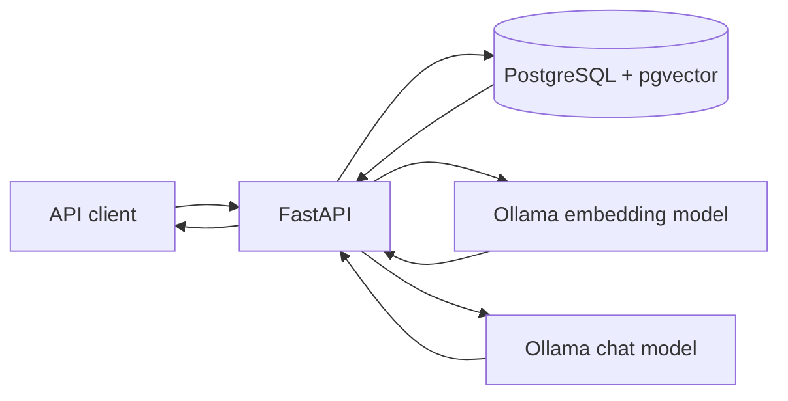

# GroundedRAG

**A local-first Retrieval-Augmented Generation (RAG) API for document question answering.**

GroundedRAG lets clients upload text and Markdown files, index their content as vector embeddings, search for semantically similar passages, and ask questions answered by a local LLM with retrieved source passages returned alongside the answer.

## Features

- UTF-8 .txt and .md document upload with a 2 MiB default size limit.
- Configurable overlapping text chunking.
- Local embeddings using Ollama and nomic-embed-text (768 dimensions).
- PostgreSQL + pgvector persistence and cosine-distance retrieval.
- Grounded answer generation through Ollama and qwen3:4b.
- FastAPI endpoints with interactive OpenAPI documentation.
- Docker Compose development stack, health endpoints, and unit tests.
- No hosted LLM API key required for local inference.

## Architecture



The API stores uploaded text and metadata in PostgreSQL. During indexing, it chunks the document, asks Ollama for an embedding per chunk, and stores the vectors in pgvector. For a question, it embeds the question, retrieves nearest chunks, passes those passages to the chat model, and returns the answer with sources.

## Quick start

Requirements: Docker Desktop/Engine and Ollama installed on the host.

```bash
git clone https://github.com/adm-l/GroundedRAG.git
cd GroundedRAG
cp .env.example .env
ollama pull nomic-embed-text
ollama pull qwen3:4b
docker compose up --build
```

API base URL: http://localhost:8000  
Swagger UI: http://localhost:8000/docs  
ReDoc: http://localhost:8000/redoc

Check health:

```bash
curl http://localhost:8000/health/live
curl http://localhost:8000/health/ready
```

For full setup and a complete upload/index/search/ask walkthrough, read [Installation](docs/INSTALLATION.md).

## API endpoints

| Method | Endpoint | Purpose |
|---|---|---|
| GET | /health/live | Liveness check |
| GET | /health/ready | Database readiness |
| POST | /documents | Upload a text or Markdown file |
| GET | /documents/{document_id} | Read document metadata |
| POST | /documents/{document_id}/process | Chunk, embed, and index a document |
| POST | /search | Semantic search over indexed chunks |
| POST | /ask | Retrieve context and generate an answer |

## Documentation

- [Installation and quick start](docs/INSTALLATION.md)
- [Architecture and request flows](docs/ARCHITECTURE.md)
- [API reference and examples](docs/API.md)
- [Database schema and vector search](docs/DATABASE.md)
- [Environment configuration](docs/CONFIGURATION.md)
- [Security controls and limitations](docs/SECURITY.md)
- [Testing guide](docs/TESTING.md)
- [Troubleshooting](docs/TROUBLESHOOTING.md)
- [Roadmap](docs/ROADMAP.md)

## Development tests

```bash
python3 -m venv .venv
source .venv/bin/activate
pip install -r requirements.txt
pytest -q
```

## Important limitations

This repository is a learning and development baseline, not a claim of production certification. Document processing and generation are synchronous. Retrieval returns the nearest chunks even if they are not relevant; a measured relevance threshold and evaluation dataset are still needed. Authentication, authorization, tenant isolation, rate limiting, durable background jobs, production secrets management, and broader integration tests are not yet implemented.

Do not expose the service to untrusted networks until the security gaps described in [Security](docs/SECURITY.md) have been addressed.

## CI policy

No GitHub Actions workflows or CI workflow files are included, per repository owner request.

## License

MIT. See [LICENSE](LICENSE).
