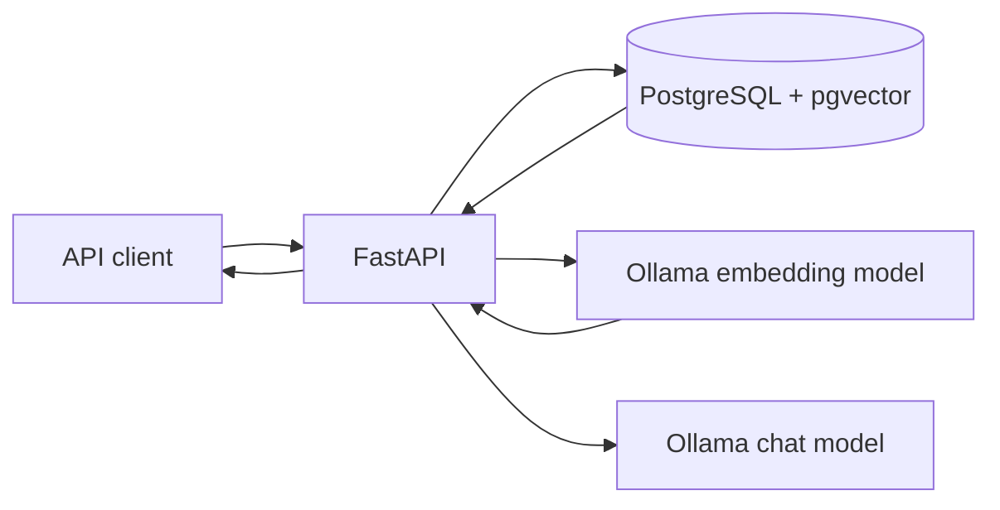

# GroundedRAG

A local-first retrieval-augmented generation (RAG) API for asking questions over uploaded text and Markdown documents. Built with FastAPI, PostgreSQL + pgvector, and Ollama.

> This repository is being initialized from the implementation developed in the accompanying ChatGPT session. The API and configuration are documented here; see the docs for the current scope and limitations.

## Features

- Upload UTF-8 `.txt` and `.md` documents (up to 2 MiB).
- Split text into overlapping chunks and create 768-dimensional embeddings with Ollama's `nomic-embed-text`.
- Store document metadata, chunks, and vectors in PostgreSQL with pgvector.
- Retrieve semantically similar chunks.
- Generate answers from retrieved context using Ollama's `qwen3:4b`.
- Docker Compose development environment, health endpoints, and automated tests.

## Architecture



## Quick start

Requirements: Docker Desktop, Python 3.11+, and Ollama installed locally.

1. Pull the models:

   ```bash
   ollama pull nomic-embed-text
   ollama pull qwen3:4b
   ```

2. Create a local environment file:

   ```bash
   cp .env.example .env
   ```

3. Start the API and database:

   ```bash
   docker compose up --build
   ```

4. Check health:

   ```bash
   curl http://localhost:8000/health/live
   curl http://localhost:8000/health/ready
   ```

The API is available at http://localhost:8000 and OpenAPI docs at http://localhost:8000/docs.

## API overview

| Method | Endpoint | Purpose |
|---|---|---|
| GET | `/health/live` | Process liveness |
| GET | `/health/ready` | Database readiness |
| POST | `/documents` | Upload a text or Markdown document |
| GET | `/documents/{document_id}` | Read document metadata |
| POST | `/documents/{document_id}/process` | Chunk, embed, and index a document |
| POST | `/search` | Semantic search over indexed chunks |
| POST | `/ask` | Retrieve context and generate an answer |

See [API reference](docs/API.md), [installation](docs/INSTALLATION.md), and [architecture](docs/ARCHITECTURE.md).

## Important limitations

- This is a development/learning baseline, not a claim of production certification.
- Ollama must be reachable from the API container; on Docker Desktop for Mac, `host.docker.internal` is used.
- Retrieval currently returns the nearest indexed chunks even when they may not be relevant. A calibrated relevance threshold and evaluation dataset are still needed.
- Document processing and answer generation are synchronous and may take time on local hardware.
- Authentication, quotas, durable background jobs, and production secret management must be added before exposing this API to untrusted users.

## License

MIT — see [LICENSE](LICENSE).
