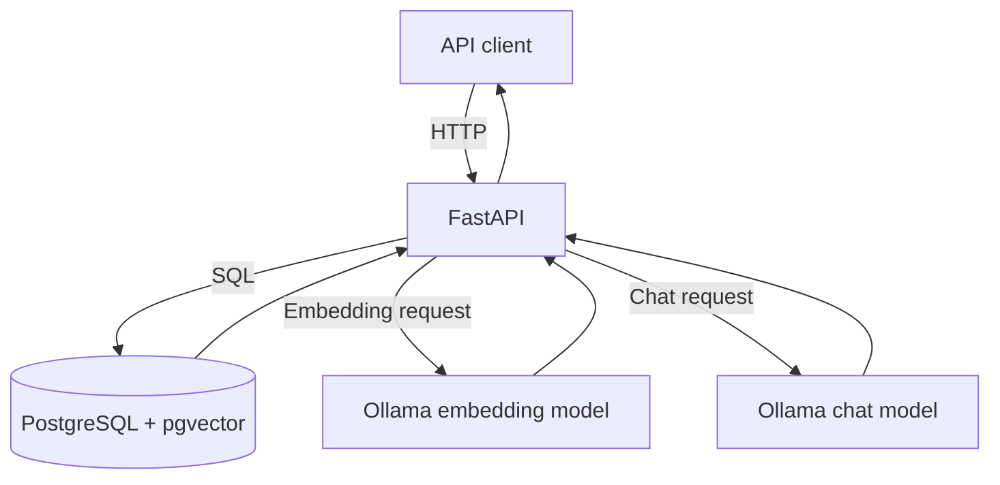

# Architecture

GroundedRAG is a synchronous, local-first RAG API. FastAPI orchestrates document persistence, embedding generation, vector retrieval, and answer generation. PostgreSQL persists source text and chunks; pgvector stores vectors and performs cosine-distance search. Ollama hosts the embedding and chat models outside the API process.

## Component diagram

## Ingestion flow

1. Client uploads UTF-8 text or Markdown.
2. API validates extension, byte limit, decoding, and non-empty content.
3. API computes SHA-256 and stores metadata and source text.
4. Client requests processing.
5. Text is split into overlapping character chunks.
6. Ollama creates an embedding for each chunk.
7. Chunks and vectors are persisted; status changes to indexed.

## Question-answering flow

1. Validate question and top_k.
2. Ollama embeds the question.
3. pgvector orders indexed chunks by cosine distance.
4. Retrieved passages are assembled into context.
5. Ollama chat is instructed to answer only from that context.
6. API returns the answer and source passages.

## Data model

- documents: filename, content type, SHA-256, extracted text, status, timestamps.
- document_chunks: FK to document with cascade delete, chunk index, text, 768-dimensional vector.
- Unique document_id plus chunk_index prevents duplicate chunk positions.
- HNSW cosine index supports approximate nearest-neighbor retrieval.

## Trade-offs and trust boundaries

Local model hosting avoids hosted inference costs, but latency depends on available RAM and compute. Synchronous indexing is simple but ties up request workers. Character-based chunking is not token-aware. Cosine distance is not a calibrated confidence score. Uploaded text is untrusted; prompt instructions mitigate but do not eliminate prompt injection. Do not expose this API publicly before adding authentication, rate limits, tenant isolation, monitoring, and security review.
